<div align="center">


# AegisPay OS

### The Deterministic Trust & Execution Operating System for Agentic Commerce on PayPal

[](./LICENSE)
[](https://aegispay-orpin.vercel.app)
[](https://developer.paypal.com)
[](./server/gemini.ts)
[](./tests)
[](./shared/kernel.ts)

**[Live Production App](https://aegispay-orpin.vercel.app)** | **[Master Setup & Deployment Guide](./MASTER_GUIDE.md)** | **[System Architecture](./docs/SYSTEM_ARCHITECTURE.md)** | **[Postman Collection v2.1](./postman/AegisPay_Collection.json)** | **[Chrome Extension MV3](./CHROMEWEBSTORE.md)**

</div>

---

## Table of Contents

1. [Executive Summary & Core Invariant](#1-executive-summary--core-invariant)
2. [Three-Tier Separation of Duties](#2-three-tier-separation-of-duties)
3. [The 6-Module Autonomous Commerce Suite](#3-the-6-module-autonomous-commerce-suite)
4. [PayPal Developer Platform Depth](#4-paypal-developer-platform-depth)
5. [Multi-Provider AI Mesh & Neural Prompt Guard](#5-multi-provider-ai-mesh--neural-prompt-guard)
6. [Stateless Enterprise Identity (Google OAuth 2.0 + Email)](#6-stateless-enterprise-identity-google-oauth-20--email)
7. [API Specification & Developer Endpoints](#7-api-specification--developer-endpoints)
8. [Sponsor & Ecosystem Integrations](#8-sponsor--ecosystem-integrations)
9. [Quickstart, Verification Suite & Vercel Deployment](#9-quickstart-verification-suite--vercel-deployment)

---

## 1. Executive Summary & Core Invariant

Autonomous AI agents and multimodal models are transforming how individuals, creators, and enterprises budget, procure tools, inspect invoices, negotiate contracts, resolve post-delivery claims, and split milestone revenue.

However, giving an LLM direct pricing or payment-capture authority introduces three structural vulnerabilities:
1. **Unbounded LLM Financial Authority**: Allowing a language model to invent spending limits, approve manipulated invoices, or output arbitrary dollar refunds exposes users and merchants to prompt-injection fund drains and hallucinated math.
2. **Single-Provider AI Fragility**: Relying on one upstream model API causes checkout verification and customer retention flows to stall during HTTP `429` rate-limit bursts or latency spikes.
3. **Fragmented Payment Tooling**: Guarding only a single step leaves blind spots across pre-spend budgeting, checkout verification, contract negotiation, milestone invoicing, and post-purchase dispute resolution.

**AegisPay OS** unifies the entire payment lifecycle under a single cryptographic rule:

> **"AI Proposes. Deterministic Code Decides. PayPal Moves the Money."**

---

## 2. Three-Tier Separation of Duties


Every commercial action inside **AegisPay OS** traverses three isolated tiers:

| Execution Tier | Primary Components | Architectural Responsibility | Security Invariant |
| :--- | :--- | :--- | :--- |
| **Tier 01: Multi-Provider Cognitive Mesh** | Google Gemini 3.5 (`Primary`) + Groq Cloud LPU (`Failover`) + Llama Prompt Guard 2 (`86M`) | Semantic invoice risk analysis, grounded policy compilation, multi-agent negotiation proposals, multimodal defect extraction, scope decomposition, and retention dialogue. | **Zero Pricing Authority**: AI schemas contain zero authoritative cent Capture or Refund fields. |
| **Tier 02: Deterministic Security Kernel** | [`shared/kernel.ts`](./shared/kernel.ts) (Zero external runtime dependencies) | Monotonic permit evaluation, number-grounding verification, single-use HMAC-SHA256 tokens, mandate clamping, Hamilton penny-exact splits, and concession ladders. | **Monotonic Safety**: AI verdicts can make a decision *stricter* (`ALLOW -> HOLD -> BLOCK`), never *looser*. Proven across 1,000 randomized fuzz cases. |
| **Tier 03: Atomic PayPal Settlement** | [`server/paypal.ts`](./server/paypal.ts) + PayPal JS SDK + AG Grid Ledger | PayPal OAuth2, Orders v2 (`CAPTURE` & `AUTHORIZE`), Vault v3 Setup Tokens, Invoicing v2 (`INV2-...`), Subscriptions v1 (`I-...`), Partial Refunds, and Signed Webhooks. | **Idempotent Execution**: Single-use nonces, atomic row locks, and SHA-256 contract hashes block replay and double-capture attacks. |

---

## 3. The 6-Module Autonomous Commerce Suite

```mermaid
flowchart LR
    AUTH["Stateless Identity\n(Google OAuth 2.0 + HMAC)"] --> M1
    M1["[01] Smart Budget & Permits\n(Vault v3 & Autopay Audit)"] --> M2
    M2["[02] Checkout Firewall\n(Single-Use HMAC + Smart SDK)"] --> M3
    M3["[03] Deal Negotiator\n(Mandate Clamp + Orders v2)"] --> M4
    M4["[04] Photo Refund Grader\n(Canvas Vision + Refund v2)"] --> M5
    M5["[05] Retention Copilot\n(20-35-50% Ladder + Subs v1)"] --> M6
    M6["[06] PayStream Studio\n(Penny-Exact Splits + INV2)"] --> AUDIT["AG Grid Ledger\n& 1,000-Case Fuzzer"]
```



### Module 01: Smart Budget, Dormant Autopays & Agent Permits
* **Editable True Free Cashflow Calculator**: Computes disposable post-bill cashflow from live checking balance, mandatory bills, savings targets, and safety buffers, and syncs safe spending caps directly into AI agent permits.
* **Plain-English Rule Compiler with Number-Grounding Guard**: Translates natural-language rules (e.g., *"Allow DevOps Agent up to $65 per tool with $40 auto-approve"*) into structured permits while `verifyGroundedNumbers` deterministically blocks any number not present in the user's prompt.
* **Dormant Autopay Auditor & PayPal Vault v3 / Subscriptions v1**: Flags dormant (`>=365` days) or price-creeping (`>15%`) recurring billing agreements for 1-click tightening/revocation, mints live **PayPal Vault v3 Setup Tokens**, and provisions **PayPal Subscriptions v1 (`I-...`)**.
* **Monotonic Permit Execution (`ALLOW` / `HOLD` / `BLOCK`)**: Low-confidence agent purchases (`68% < 82%`) automatically downgrade from `CAPTURE` to `intent: "AUTHORIZE"`, holding funds until a human operator explicitly captures or voids the authorization.

### Module 02: Pre-Payment Checkout Firewall & Tamper Lab
* **Multi-Currency & Multimodal Invoice Scanner**: Evaluates payment requests, uploaded invoice screenshots, and live **PayPal `INV2-...` Sandbox invoices** across `USD`, `EUR`, `GBP`, and `INR` (with live ECB/Frankfurter FX conversion) using **Groq `llama-prompt-guard-2-86m`**, **Gemini 3.5 / Groq LPU**, and **18 deterministic fraud rules**.
* **Embedded PayPal JS SDK Smart Payment Buttons**: When a scan passes (`ALLOW`), the kernel mints a single-use, 5-minute HMAC-SHA256 token and unlocks official **PayPal Smart Payment Buttons** alongside a 5-attack **Capture Tamper Lab** (`MUTATE_AMOUNT`, `PAYEE_SWAP`, `FORGE_SIGNATURE`, `EXPIRED_TOKEN`, `TOKEN_REPLAYED`).
* **Manifest V3 Chrome Extension (`/extension.zip`)**: Highlight any payment text on any site, right-click **"Scan Payment Text with AegisPay"**, and verify in the browser Side Panel with automatic `localhost:8787` to `aegispay-orpin.vercel.app` failover.

### Module 03: Autonomous Deal Negotiator & Smart Escrow
* **Sealed Buyer & Seller Mandates + Human Takeover**: Autonomous Buyer and Seller agents negotiate price, delivery SLA, revisions, and upfront deposit percentage inside private ZOPA bounds, with optional **Human Takeover** counter-offers at any point.
* **Prompt-Injection Stripper & Dual PayPal Settlement**: Strips adversarial injection payloads mid-round, signs a canonical **SHA-256 Deal Contract**, captures the upfront order via **PayPal Orders v2**, and optionally issues a live **PayPal Invoicing v2 (`INV2-...`)** deposit invoice.

### Module 04: Instant Keep-The-Item Photo Refund
* **Real Pixel Inspection (Drag-and-Drop Upload + HTML5 Canvas Generator)**: Supports uploading real product defect photos or rendering pixel-authentic PNG inspection images via HTML5 `<canvas>` (`src/productCanvas.ts`) so real image bytes hit **Gemini 3.5 / Qwen 3.8 Vision**.
* **Non-Monetary Vision Telemetry + Editable Merchant Matrix**: Vision AI outputs only physical defect classifications (`defectCategory`, `severityTier`, `affectedSurfacePct`, `photoAuthenticityConfidence`). Deterministic code applies merchant-configured tier sliders, enforces SHA-256 duplicate-photo replay locks, computes unit-economics savings vs. return shipping, and executes **PayPal Captures Partial Refund (`/v2/payments/captures/{id}/refund`)**.

### Module 05: Subscription Retention Copilot
* **Interactive Retention Chat & Fixed Concession Ladder**: Enforces `Step 1 (20% Off) -> Step 2 (35% Off) -> Step 3 (50% Hard Floor)` while Gemini/Groq crafts empathetic responses.
* **Active-Usage & Legal Circuit Breakers**: Accounts with `>=60%` feature utilization are blocked from discount gaming (offered a 14-day pause instead). Any mention of `"chargeback"`, `"dispute"`, `"lawyer"`, `"attorney"`, or `"sue"` kills the AI session, locks discount at `0%`, dispatches a **Zapier Escalation Webhook**, and enforces atomic row-lock idempotency before provisioning a discounted **PayPal Subscription (`I-...`)**.

### Module 06: PayStream Smart-Milestone & Proof-of-Delivery Studio
* **AI Scope Decomposition + Largest-Remainder Penny-Exact Splits**: Decomposes client project briefs into verifiable milestones and applies Hamilton's **Largest-Remainder integer allocation** (`allocatePennyExact`) so milestone totals and multi-collaborator revenue splits sum to the exact cent (`0-cent` rounding drift even on prime budgets like `$2,450.03`).
* **1-Click Live PayPal `INV2-...` Invoicing & Proof-of-Delivery Auditor**: Issues real **PayPal Sandbox Invoices (`INV2-...`)** per milestone with clickable payer URLs, and audits submitted deliverable URLs/notes against acceptance criteria with monotonic prompt-injection protection before unlocking collaborator split schedules.

---

## 4. PayPal Developer Platform Depth

Implemented in [`server/paypal.ts`](./server/paypal.ts) and [`src/PayPalSmartCheckout.tsx`](./src/PayPalSmartCheckout.tsx):

| PayPal Capability | REST Endpoint / SDK | Where Used in AegisPay OS |
| :--- | :--- | :--- |
| **OAuth 2.0 Client Credentials** | `POST /v1/oauth2/token` | Live bearer token lifecycle across all server-side PayPal calls |
| **Orders v2 (`CAPTURE` & `AUTHORIZE`)** | `POST /v2/checkout/orders` | Module 01 Agent Permits, Module 02 Firewall, Module 03 Escrow |
| **PayPal JS SDK Smart Buttons** | `@paypal/sdk-js` (`buttons`) | Module 02 Unlocked Buyer Checkout + Sandbox Approval Links |
| **Authorizations Capture & Void** | `POST /v2/payments/authorizations/{id}/capture` & `/void` | Module 01 Human-in-the-Loop resolution for held agent purchases |
| **Captures Partial Refund** | `POST /v2/payments/captures/{id}/refund` | Module 04 Keep-The-Item deterministic partial refunds |
| **Invoicing v2 (Draft, Send & Lookup)** | `POST /v2/invoicing/invoices` & `/send` | Module 06 PayStream Milestones, Module 03 Deposits, Module 02 Lookup |
| **Vault v3 Setup Tokens** | `POST /v3/vault/setup-tokens` | Module 01 Delegated AI Agent payment credential provisioning |
| **Catalogs, Plans & Subscriptions v1** | `POST /v1/catalogs/products`, `/v1/billing/plans`, `/v1/billing/subscriptions` | Module 01 Monitored Subscriptions & Module 05 Discounted Retention Plans |
| **Cryptographic Webhooks** | `POST /v1/notifications/verify-webhook-signature` & `/api/paypal/webhook` | Real-time signed event ledger across all 6 modules |

---

## 5. Multi-Provider AI Mesh & Neural Prompt Guard

Implemented in [`server/gemini.ts`](./server/gemini.ts):
1. **Primary Cognitive Tier**: Google Gemini 3.5 (`gemini-3.5-flash-lite` -> `gemini-3.8-flash` -> `gemini-3.5-flash`) for structured JSON reasoning and multimodal defect telemetry.
2. **Automatic Sub-Second Failover**: On HTTP `429`, `5xx`, or timeout, requests automatically reroute to **Groq Cloud LPU** (`openai/gpt-oss-120b` for structured text and `qwen/qwen3.8-27b` for multimodal vision). Testable live via the header **"Test 429 -> Groq"** toggle (`POST /api/ai/failover-test`).
3. **Neural Prompt-Injection Classifier**: Groq `meta-llama/llama-prompt-guard-2-86m` scores untrusted inputs alongside deterministic kernel rules.

---

## 6. Stateless Enterprise Identity (Google OAuth 2.0 + Email)

Implemented in [`server/index.ts`](./server/index.ts) and [`shared/kernel.ts`](./shared/kernel.ts):
* **Google OAuth 2.0 (`GET /api/auth/google/url`, `GET /api/auth/google/callback`, `POST /api/auth/google`)**: Full OAuth 2.0 Authorization Code + OpenID Connect UserInfo exchange, with an instant Google Account Chooser fallback when testing before redirect URIs are whitelisted.
* **Stateless Serverless Sessions (`signStatelessSession` / `verifyStatelessSession`)**: Session tokens (`aegis_sess_.<claims>.<hmac>`) are cryptographically signed with HMAC-SHA256 so authentication survives Vercel Serverless cold starts without sticky memory.

---

## 7. API Specification & Developer Endpoints

| Method & Endpoint | Module | Description |
| :--- | :--- | :--- |
| `GET /api/state` | Core Telemetry | Returns system health, KPIs, permits, PayStream plans, orders, invoices, webhooks, and audit logs. |
| `POST /api/credentials` | Runtime Vault | Updates runtime PayPal, Gemini, Groq, Google OAuth, or Zapier keys and verifies PayPal OAuth2. |
| `POST /api/ai/failover-test` | AI Router | Simulates HTTP `429` on Gemini to verify live automatic failover to Groq Cloud LPU. |
| `GET /api/auth/google/url` | Identity | Builds Google OAuth 2.0 authorization URL with CSRF state parameter. |
| `POST /api/auth/register` / `login` | Identity | Registers or authenticates operators and issues stateless HMAC-SHA256 bearer tokens. |
| `POST /api/lupa/cashflow-check` | Module 01 | Computes True Free Cashflow affordability (`ALLOW` / `HOLD` / `BLOCK`) and syncs agent caps. |
| `POST /api/lupa/compile-policy` | Module 01 | Compiles plain-English spending rules with deterministic Number-Grounding verification. |
| `POST /api/lupa/mint-vault-permit` | Module 01 | Mints a live PayPal Vault v3 Setup Token (`POST /v3/vault/setup-tokens`). |
| `POST /api/lupa/agent-pay` | Module 01 | Evaluates monotonic permit policy and creates PayPal `CAPTURE` or `AUTHORIZE` order. |
| `POST /api/scamshield/review` | Module 02 | Scans text/screenshots/invoices (`USD`/`EUR`/`GBP`/`INR`) and mints single-use HMAC token. |
| `POST /api/scamshield/capture` | Module 02 | Consumes single-use HMAC token or blocks tampered amounts, payees, signatures, or replays. |
| `POST /api/dealforge/negotiate` | Module 03 | Runs Buyer/Seller/Human negotiation, clamps mandates, signs SHA-256 contract, and settles on PayPal. |
| `POST /api/cliprefund/evaluate-and-refund` | Module 04 | Runs multimodal Vision inspection, applies Merchant Matrix, and issues PayPal Partial Refund. |
| `POST /api/churnrescue/intercept` | Module 05 | Enforces 20-35-50% ladder, `>=60%` usage guard, legal circuit breaker, and discounted Subscription. |
| `POST /api/paystream/create-plan` | Module 06 | Decomposes project brief into penny-exact Largest-Remainder milestones and collaborator splits. |
| `POST /api/paystream/issue-invoice` | Module 06 | Issues and sends a live PayPal Sandbox Invoice (`INV2-...`) bound to the plan SHA-256 hash. |
| `POST /api/paystream/verify-proof` | Module 06 | Audits deliverable proof against acceptance criteria and unlocks collaborator split schedule. |
| `POST /api/security/fuzz` | Security | Executes 1,000 randomized adversarial fuzz cases across all 6 invariants in `<25ms`. |

---

## 8. Sponsor & Ecosystem Integrations

* **PayPal Developer Platform**: Orders v2, Authorizations Capture/Void, Captures Partial Refund, Invoicing v2, Vault v3 Setup Tokens, Catalogs/Plans/Subscriptions v1, PayPal JS SDK Smart Buttons, and Signed Webhooks.
* **Google Gemini 3.5 + Groq Cloud LPU + Meta Llama Prompt Guard 2**: Multi-provider AI reasoning, vision telemetry, sub-second rate-limit failover, and neural prompt-injection classification.
* **AG Grid (`ag-grid-react` v33)**: Filterable cryptographic audit and PayPal settlement ledger in the Overview console.
* **Postman**: 10-request Postman Collection v2.1 ([`postman/AegisPay_Collection.json`](./postman/AegisPay_Collection.json)) covering all 6 modules.
* **Elastic**: One-click Elasticsearch Bulk NDJSON audit exporter (`/api/export/elastic-ndjson`).
* **Zapier**: Outbound webhook automation triggered automatically on legal/chargeback circuit-breaker events.
* **Model Context Protocol (MCP) & WebMCP**: Standalone 6-tool JSON-RPC 2.0 MCP server ([`mcp-server/index.mjs`](./mcp-server/index.mjs)) for Claude Desktop/Cursor plus browser `navigator.modelContext` registration ([`src/webmcp.ts`](./src/webmcp.ts)).
* **Vercel & Render**: Pre-bundled ESM serverless function ([`api/index.js`](./api/index.js) + [`vercel.json`](./vercel.json)) and Render Blueprint ([`render.yaml`](./render.yaml)).

---

## 9. Quickstart, Verification Suite & Vercel Deployment

### 1. Install Dependencies & Run the 335-Test Verification Suite
```bash
npm install
npm test
```

### 2. Configure Environment (Optional for Local Sandbox, Recommended for Live APIs)
Copy [`.env.example`](./.env.example) to `.env` and populate your PayPal Sandbox, Gemini, Groq, and Google OAuth credentials (or paste them live in the console via the **API Keys** drawer in the top navigation bar).

### 3. Build & Run on Localhost (`http://localhost:8787`)
```bash
npm run build
npm start
```
Open **[http://localhost:8787](http://localhost:8787)** to explore the Landing Page, Google OAuth 2.0 + Email Authentication, and all 6 interactive PayPal + AI modules.

### 4. Connect an External AI Agent via MCP (Optional)
```bash
node mcp-server/index.mjs
```

### 5. Deploy to Vercel
Push to `main` or run `npx vercel --prod`. See **[`MASTER_GUIDE.md`](./MASTER_GUIDE.md)** for exact Vercel Environment Variable names, Google Cloud Console Redirect URIs, Devpost submission text, and the `<3:00` demo video script.

---

## License

Distributed under the **MIT License**. See [`LICENSE`](./LICENSE) for details.
