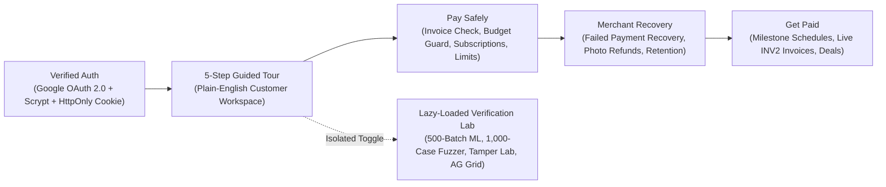

<div align="center">


# AegisPay v3.1

### Safer Payments, Automated Failed-Payment Recovery & Milestone Billing on PayPal

[](./LICENSE)
[](https://aegispay-orpin.vercel.app)
[](https://developer.paypal.com)
[](./shared/payrevive.ts)
[](./tests)

**[Live Production App](https://aegispay-orpin.vercel.app)** | **[Master Setup & Deployment Guide](./MASTER_GUIDE.md)** | **[System Architecture](./docs/SYSTEM_ARCHITECTURE.md)** | **[Postman Collection v2.1](./postman/AegisPay_Collection.json)** | **[Chrome Extension MV3](./CHROMEWEBSTORE.md)**

</div>

---

## 1. Product Experience vs. Isolated Verification Lab

**AegisPay v3.1** strictly separates the everyday customer product from engineering benchmarks and adversarial test harnesses:

1. **Clean Customer Workspace (`Overview`, `Pay Safely`, `Merchant Recovery`, `Get Paid`)**:
   - Plain-English, symmetrical **Midnight Black (`#050507`) + Electric Cobalt (`#0047FF`) + Acid Lime (`#CCFF00`)** interface with zero internal ML/cryptographic jargon exposed to end users.
   - Includes an accessible **5-Step Interactive Guided Tour** (`src/components/InteractiveTour.tsx`) that automatically walks new users through every workflow with live **Try Sample Action** buttons and spotlight focus rings, replayable anytime from the header.
2. **Lazy-Loaded Verification Lab (`src/components/DiagnosticsLab.tsx`)**:
   - Code-split via `React.lazy` so `AG Grid` and benchmark tooling never bloat the customer entry bundle.
   - Houses the **500-Batch PayRevive Simulation**, **Held-Out GBDT Model Card & TreeSHAP Waterfall**, **1,000-Case Property-Based Safety Fuzzer**, **5-Scenario Checkout Tamper Lab**, **Gemini-to-Groq HTTP 429 Failover Tester**, **AG Grid Cryptographic Audit Ledger** (CSV + Elastic NDJSON export), and **`PRINCIPAL_ARCHITECT` Admin RBAC Controls**.


| Execution Tier | Primary Components | Architectural Responsibility | Security Invariant |
| :--- | :--- | :--- | :--- |
| **Tier 01: Cognitive & ML Mesh** | Google Gemini (`Primary`) + Groq Cloud LPU (`Failover`) + Llama Prompt Guard 2 + **Trained Newton GBDT + TreeSHAP** | Invoice scam review, policy compilation, multi-agent negotiation, vision defect grading, milestone planning, and failed-payment root-cause diagnosis. | **Zero Direct Pricing Authority**: AI/ML outputs feed deterministic bounds, Net-EV checks, and compliance gates. |
| **Tier 02: Deterministic Security Kernel** | [`shared/kernel.ts`](./shared/kernel.ts) & [`shared/payrevive.ts`](./shared/payrevive.ts) | Monotonic permit evaluation, number-grounding guard, single-use HMAC tokens, mandate clamping, Hamilton penny-exact splits, Disjoint LinUCB bandit, and hard compliance gates. | **Monotonic & Compliant**: AI can tighten (`ALLOW -> HOLD -> BLOCK`), never loosen. `0` compliance violations across 500-batch and 1,000-case suites. |
| **Tier 03: Atomic PayPal Settlement** | [`server/paypal.ts`](./server/paypal.ts) + PayPal JS SDK + Per-Tenant Isolation | PayPal OAuth2, Orders v2 (`CAPTURE` & `AUTHORIZE`), Vault v3 Setup Tokens, Invoicing v2 (`INV2-...`), Subscriptions v1 (`I-...`), Partial Refunds, and Verified Webhooks. | **Idempotent & Honest Settlement**: Tracks exact settlement stage (`LIVE_PAYER_APPROVAL_READY` vs `LIVE_BUYER_CAPTURED`) and enforces per-tenant isolation. |

---

## 2. Core Workflows & Technical Capabilities



### 1. Failed-Payment Revenue Recovery (`shared/payrevive.ts` & `scripts/train-payrevive-gbdt.ts`)
* **Trained 16-Tree Second-Order Newton GBDT + Exact TreeSHAP**: Trained via `npm run train:payrevive` on `N=12,000` labeled payment telemetry records and evaluated on an untouched `N=3,000` held-out split (`ROC-AUC: 0.8301`, `Brier Score: 0.1403`). Computes exact path-dependent TreeSHAP attributions (`additivityDelta < 1e-6`).
* **Disjoint LinUCB Contextual Bandit (`Sherman-Morrison` Ridge Updates)**: Evaluates Expected Net Recovery (`P(recover | x, action) * amountCents - actionCostCents`) across PayPal Orders v2 Jitter Retries, Payday Smart Retries, PayPal Backup Funding Links (`INV2-...`), and Split Two-Part Invoices—updating arm weights strictly upon verified settlement (`POST /api/payrevive/confirm-settlement`) and abstaining when fees exceed expected value.
* **Hard Deterministic Compliance Gate**: Blocks retries and customer outreach on stolen/revoked hard declines, `>=3` retries in 30 days, open PayPal disputes, TCPA/GDPR opt-outs, and customer quiet hours (`21:00-07:59`).
* **One-Command 500-Batch Benchmark (`npm run benchmark:payrevive`)**: Across `500` non-stationary noisy batch runs (`10,000` failed payments), recovers **`+51.35%` more net revenue** than a strong hand-written production dunning rule system with **`0` compliance violations**.

### 2. Pay Safely (`src/components/PaySafelyView.tsx`)
* **Invoice Safety Check**: Scans pasted invoices, screenshots, and live PayPal `INV2-...` links (`USD`/`EUR`/`GBP`/`INR`), unlocking **PayPal Smart Payment Buttons** via a 5-minute single-use token.
* **Budget Guard, Subscription Cleanup & Spending Limits**: Computes true disposable post-bill balance, cancels or caps dormant PayPal autopays, compiles plain-English spending rules (`verifyGroundedNumbers`), mints **PayPal Vault v3 Setup Tokens**, and holds uncertain purchases via `intent: "AUTHORIZE"`.

### 3. Merchant Recovery, Photo Refunds & Subscriber Retention (`src/components/MerchantRecoveryView.tsx`)
* **Keep-The-Item Photo Refunds**: Multimodal Vision defect telemetry mapped to per-tenant merchant cent matrices with SHA-256 duplicate-photo replay protection and **PayPal Partial Refunds**.
* **Subscriber Retention Desk**: Enforces `20% -> 35% -> 50%` discount bounds, blocks `>=60%` active-usage discount gaming, halts automated offers at `0%` on chargeback/legal keywords with human support escalation, and prevents double-click duplicate charges.

### 4. Get Paid: Milestone Billing & Deal Escrow (`src/components/GetPaidView.tsx`)
* **Exact-Cent Milestone Billing**: Uses Hamilton's Largest-Remainder method (`allocatePennyExact`) for `0-cent` rounding drift across milestones and team splits, sends live **PayPal Sandbox Invoices (`INV2-...`)**, and verifies deliverable proof notes/links.
* **Automated Deal Negotiation**: Clamps Buyer and Seller agent offers inside confidential mandate ceilings/floors and settles via **PayPal Orders v2** + **Invoicing v2**.

---

## 3. OWASP Security Hardening & Multi-Tenant Architecture

* **Verified Authentication & `HttpOnly` Cookie Transport (`server/index.ts`, `server/security.ts`)**:
  * **Google OAuth 2.0**: Server-side authorization code exchange + `oauth2.googleapis.com/tokeninfo` verification (`aud === GOOGLE_CLIENT_ID`, `email_verified === true`) protected by a signed 10-minute `aegis_oauth_state` CSRF cookie. Zero unverified email session minting; zero session tokens in URL query strings or `localStorage`.
  * **Email & Isolated Demo Sandbox**: `crypto.scryptSync` (`N=16384, r=8, p=1`, 16B random salt, `timingSafeEqual`) for email accounts, plus an isolated non-privileged `DEMO_OPERATOR` sandbox (`POST /api/auth/demo`) blocked (`403 Forbidden`) from admin credential endpoints.
* **Strict CORS, CSRF, SSRF, CSP & Webhook Verification**:
  * Explicit Origin Allowlist CORS, cookie CSRF header/origin enforcement (`X-Requested-With: AegisPay-Client`), strict `script-src 'self' https://www.paypal.com` CSP (no `'unsafe-inline'`), SSRF blocking (`validateSafeExternalUrl` rejects loopback, RFC1918 private IPs, and `169.254.169.254`), and cryptographic webhook signature verification (`POST /api/paypal/webhook`).
* **Non-Blocking Multi-Tenant Persistence (`server/store.ts`)**:
  * Coalesced async write-ahead atomic vault (`fs.promises.writeFile` + `rename` with `0o600` permissions in `data/aegispay_store.json`, git-ignored) with strict per-tenant isolation across PayPal orders, invoices, vault tokens, subscriptions, bandit matrices, refund policies, and `2,000`-tenant LRU caching.

---

## 4. Quickstart & One-Command Verification

```bash
npm install
npm test
npm run benchmark:payrevive
npm run build
npm start
```

Open **[http://localhost:8787](http://localhost:8787)**. For environment variables, Google OAuth redirect URIs, MCP server usage (`node mcp-server/index.mjs`), and Vercel deployment, see **[`MASTER_GUIDE.md`](./MASTER_GUIDE.md)**.

---

## License

Distributed under the **MIT License**. See [`LICENSE`](./LICENSE) for details.
