<div align="center">


# AegisPay OS v3.0

### Autonomous AI Commerce, Security & Revenue Recovery Platform on PayPal

[](./LICENSE)
[](https://aegispay-orpin.vercel.app)
[](https://developer.paypal.com)
[](./shared/payrevive.ts)
[](./tests)

**[Live Production App](https://aegispay-orpin.vercel.app)** | **[Master Setup & Deployment Guide](./MASTER_GUIDE.md)** | **[System Architecture](./docs/SYSTEM_ARCHITECTURE.md)** | **[Postman Collection v2.1](./postman/AegisPay_Collection.json)** | **[Chrome Extension MV3](./CHROMEWEBSTORE.md)**

</div>

---

## 1. Core Architectural Invariant

Giving an LLM direct pricing, dunning, or payment-capture authority exposes users and merchants to prompt-injection fund drains, ungrounded policy limits, non-compliant retries, and rounding drift. **AegisPay OS v3.0** unifies autonomous commerce and failed-payment recovery on the PayPal Developer Platform under one deterministic rule:

> **"AI Proposes. Deterministic Code Decides. PayPal Moves the Money."**


| Execution Tier | Primary Components | Architectural Responsibility | Security Invariant |
| :--- | :--- | :--- | :--- |
| **Tier 01: Cognitive & ML Mesh** | Google Gemini (`Primary`) + Groq Cloud LPU (`Failover`) + Llama Prompt Guard 2 + **PayRevive XGBoost/TreeSHAP** | Semantic invoice analysis, policy compilation, multi-agent negotiation, vision defect grading, scope decomposition, and failed-payment root-cause diagnosis. | **Zero Direct Pricing Authority**: AI/ML outputs feed deterministic bounds, Net-EV checks, and compliance gates. |
| **Tier 02: Deterministic Security Kernel** | [`shared/kernel.ts`](./shared/kernel.ts) & [`shared/payrevive.ts`](./shared/payrevive.ts) | Monotonic permit evaluation, number-grounding guard, single-use HMAC tokens, mandate clamping, Hamilton penny-exact splits, and hard dunning compliance gates. | **Monotonic & Compliant**: AI can tighten (`ALLOW -> HOLD -> BLOCK`), never loosen. `0` compliance violations proven across 500-batch and 1,000-case fuzz suites. |
| **Tier 03: Atomic PayPal Settlement** | [`server/paypal.ts`](./server/paypal.ts) + PayPal JS SDK + AG Grid Ledger | PayPal OAuth2, Orders v2 (`CAPTURE` & `AUTHORIZE`), Vault v3 Setup Tokens, Invoicing v2 (`INV2-...`), Subscriptions v1 (`I-...`), Partial Refunds, and Signed Webhooks. | **Idempotent Execution**: Single-use nonces, atomic row locks, and SHA-256 audit hashes prevent replay and duplicate captures. |

---

## 2. The 7-Module Autonomous Commerce & Recovery Suite

```mermaid
flowchart LR
    AUTH["Mandatory Zero-Trust Auth\n(Google OAuth 2.0 + Scrypt + HMAC)"] --> M7
    M7["[01] PayRevive Recovery\n(XGBoost + TreeSHAP + Bandit)"] --> M1
    M1["[02] Budget & Permits\n(Vault v3 & Autopay Audit)"] --> M2
    M2["[03] Checkout Firewall\n(Single-Use HMAC + Smart SDK)"] --> M3
    M3["[04] Deal Negotiator\n(Mandate Clamp + Orders v2)"] --> M4
    M4["[05] Photo Refund Grader\n(Canvas Vision + Refund v2)"] --> M5
    M5["[06] Retention Copilot\n(20-35-50% Ladder + Subs v1)"] --> M6
    M6["[07] PayStream Studio\n(Penny-Exact Splits + INV2)"] --> AUDIT["AG Grid Ledger\n& 1,000-Case Fuzzer"]
```



### 1. PayRevive: Autonomous Failed-Payment Revenue Recovery (`shared/payrevive.ts`)
* **XGBoost Ensemble + Exact TreeSHAP Diagnosis**: Evaluates 8 payment telemetry signals across a 12-tree Gradient Boosted Decision Tree ensemble and computes exact path-dependent TreeSHAP log-odds contributions (`additivityDelta < 1e-6`) to isolate why a payment failed (`TRANSIENT_ISSUER_TIMEOUT`, `LIQUIDITY_PAYDAY_GAP`, `DEGRADED_FUNDING_INSTRUMENT`, `COMPLIANCE_HARD_DECLINE`, `LOW_INTENT_EXHAUSTED_RETRIES`).
* **Cost-Aware Contextual Bandit**: Evaluates Expected Net Recovery (`P(recover | x, action) * amountCents - actionCostCents`) across PayPal Orders v2 Jitter Retries, Payday Smart Retries, PayPal Backup Funding Switches, and Split Two-Part Invoices—automatically abstaining (`ABSTAIN_NOT_WORTH_COST`) on micro-payments where retry fees exceed expected recovery.
* **Hard Deterministic Compliance Gate & SHA-256 Audit Trail**: Blocks retries and outreach on fraud/stolen hard declines, revoked mandates, `>=3` retries in 30 days, open PayPal disputes, TCPA/GDPR opt-outs, and customer quiet hours (`21:00–07:59`), logging every decision to the cryptographic ledger.
* **One-Command 500-Batch Benchmark (`npm run benchmark:payrevive`)**: Across `500` batch runs (`10,000` failed payments), PayRevive recovers **`+66.36%` more net revenue** (`$387,980.27` vs `$233,223.40`, `+$154,756.87` extra net recovered) than a hand-written production rule system with **`0` compliance violations**.

### 2. Smart Budget, Dormant Autopays & Agent Permits
* **True Free Cashflow & Grounded Rule Compiler**: Calculates disposable post-bill cashflow, compiles plain-English agent rules while `verifyGroundedNumbers` blocks hallucinated caps, audits dormant (`>=365d`) autopays, mints **PayPal Vault v3 Setup Tokens**, and holds low-confidence agent purchases via PayPal `intent: "AUTHORIZE"`.

### 3. Pre-Payment Checkout Firewall & Tamper Lab
* **Multimodal & Multi-Currency Invoice Defense**: Scans payment text, screenshots, and live PayPal `INV2-...` invoices (`USD`/`EUR`/`GBP`/`INR`) with **Llama Prompt Guard 2 (`86M`)**, **Gemini / Groq**, and **18 deterministic rules**, unlocking **PayPal Smart Payment Buttons** via a single-use 5-minute HMAC token. Includes a Manifest V3 Chrome Extension (`/extension.zip`).

### 4. Autonomous Deal Negotiator & Smart Escrow
* **Sealed ZOPA Mandates + Dual PayPal Settlement**: Buyer and Seller agents (with optional Human Takeover) negotiate price, delivery SLA, revisions, and deposit percentage inside clamped ceilings/floors, neutralizing prompt injection and settling via **PayPal Orders v2** + **Invoicing v2 (`INV2-...`)**.

### 5. Instant Keep-The-Item Photo Refund
* **Non-Monetary Vision Telemetry + Partial Refund**: Inspects uploaded or HTML5 Canvas defect photos via multimodal Vision AI, maps physical severity to merchant-controlled cent matrices, blocks duplicate image SHA-256 replays, and executes **PayPal Partial Refunds (`/v2/payments/captures/{id}/refund`)**.

### 6. Subscription Retention Copilot
* **Fixed Concession Ladder & Circuit Breakers**: Enforces `20% -> 35% -> 50%` discount bounds, blocks `>=60%` active-usage discount gaming, kills the AI session at `0%` on legal/chargeback threats with a **Zapier Escalation Webhook**, and enforces atomic row-lock idempotency on **PayPal Subscriptions v1**.

### 7. PayStream Smart-Milestone & Proof-of-Delivery Studio
* **Hamilton Penny-Exact Splits + Live `INV2-...` Invoicing**: Decomposes project briefs into milestones and collaborator splits with `0-cent` rounding drift (`allocatePennyExact`), issues live **PayPal Sandbox Invoices (`INV2-...`)**, and verifies deliverable proofs against acceptance criteria.

---

## 3. Zero-Trust Security, Data Storage & Horizontal Scalability

* **Mandatory Authentication (Never Optional)**: Unauthenticated requests to `/api/state` and all protected `/api/*` endpoints return `401 AUTH_REQUIRED`. Operators authenticate via **Google OAuth 2.0**, **`crypto.scryptSync` (`N=16384`, 16B salt, constant-time `timingSafeEqual`) Email Sign-Up/Sign-In**, or the Sandbox Operator session handshake (`HttpOnly; SameSite=Strict` cookie + signed HMAC-SHA256 bearer token).
* **Where User Data Is Stored (`server/store.ts`)**:
  * **Local / Dedicated Node**: Stored in `data/aegispay_store.json` (`0o600` owner-only permissions, atomic write-ahead `.tmp` + `fs.renameSync`, git-ignored).
  * **Serverless (Vercel)**: Stored in `/tmp/aegispay_store.json` paired with stateless HMAC-SHA256 session tokens (`aegis_sess_.<claims>.<hmac>`) so identity and tenant partitioning work seamlessly across cold starts without sticky instances.
  * **Multi-Tenant Isolation & Bounded Memory**: Every authenticated operator receives an isolated `TenantWorkspace` inside a bounded `2,000`-tenant LRU memory cache (`max 250` audit rows per tenant).
* **Zero Secret Leaks & Industry Security Standards (`server/security.ts`)**:
  * Zero API keys or secrets are stored in client bundles, Git history, or browser `localStorage`. Server-side error/log strings pass through `redactSecrets`.
  * Enforces `Content-Security-Policy`, `Strict-Transport-Security`, `X-Frame-Options: DENY`, `X-Content-Type-Options: nosniff`, `Referrer-Policy`, `Permissions-Policy`, prototype-pollution key sanitization, and a **3-tier Sliding-Window Rate Limiter** (`AUTH`, `MUTATION`, `READ`) emitting standard `RateLimit-*` and `Retry-After` (`HTTP 429`) headers.

---

## 4. Quickstart, One-Command Benchmark & Deployment

### 1. Install Dependencies & Run Verification Suites
```bash
npm install
npm test
npm run benchmark:payrevive
```

### 2. Configure `.env` & Run Production Server on Localhost (`http://localhost:8787`)
Copy [`.env.example`](./.env.example) to `.env` (git-ignored), populate PayPal Sandbox, Gemini, Groq, and Google OAuth credentials, then build and start:
```bash
npm run build
npm start
```
Open **[http://localhost:8787](http://localhost:8787)**.

### 3. Model Context Protocol (MCP) Server (7 Tools)
```bash
node mcp-server/index.mjs
```
Exposes `aegispay_list_permits`, `aegispay_check_cashflow`, `aegispay_agent_pay`, `aegispay_scamshield_review`, `aegispay_paystream_create_plan`, `aegispay_paystream_issue_invoice`, and `aegispay_payrevive_recover`.

### 4. Vercel Deployment
Push to `main` or run `npx vercel --prod`. Full environment variable and OAuth setup instructions are in **[`MASTER_GUIDE.md`](./MASTER_GUIDE.md)**.

---

## License

Distributed under the **MIT License**. See [`LICENSE`](./LICENSE) for details.
