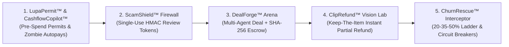

# 🛡️ AegisPay — The Deterministic Trust & Execution OS for Agentic Commerce on PayPal

> **"AI Proposes. Deterministic Code Decides. PayPal Moves the Money."**  
> Built for the **Build What's Next with PayPal and AI** Global Hackathon • **MIT License** • **313 Passing Tests** • **1,000-Case Property-Based Safety Fuzzer**

---

## 🌟 Why AegisPay Exists

AI is transforming how people and autonomous agents budget, buy, negotiate, resolve disputes, and manage subscriptions. Yet across the AI commerce landscape, two fatal failure modes persist:
1. **Unbounded AI Autonomy**: Giving an LLM direct pricing or payment authority risks hallucinated discounts, prompt-injection fund drains, and unauthorized charges.
2. **Fragmented Point Solutions**: Existing tools only guard a single slice of a transaction—leaving buyers and merchants exposed before checkout, during negotiation, or after delivery.

**AegisPay** solves both problems by uniting the **entire 5-Stage Autonomous Commerce Lifecycle** on top of the **PayPal Developer Sandbox Platform** (`Orders v2`, `Authorizations & Captures`, `Captures Partial Refund`, `Billing Permissions`, and `Signed Webhooks`) governed by a zero-trust **Deterministic Financial & Cryptographic Kernel**.

---

## 🏗️ The 5-Stage Autonomous Commerce Lifecycle



### 1️⃣ Stage 1: `LupaPermit™` & `CashflowCopilot™` (Buyer-Side Agentic Permits & Affordability)
* **True Free Cashflow Copilot**: Connects checking balance, upcoming rent, loan repayments, active PayPal autopays, and savings goals to answer *"Can I afford this purchase right now?"* and automatically calibrates AI agent spending caps.
* **Zombie Autopay Detector**: Audits PayPal recurring billing agreements (`BA-...`) to flag permissions silent for $>1$ year, unused subscriptions, and unapproved price creep ($>15\%$), allowing 1-click revocation or cap tightening.
* **Monotonic Agent Permit API (`ALLOW` / `HOLD` / `BLOCK`)**: Delegates scoped spending slices to AI agents (via **MCP Server** & **Browser WebMCP**).
  * `ALLOW` $\rightarrow$ Creates & captures a PayPal Sandbox Order (`intent: "CAPTURE"`).
  * `HOLD` $\rightarrow$ Creates a PayPal Order Authorization (`intent: "AUTHORIZE"`) when confidence is below threshold (e.g. $68\% < 82\%$) so the agent **cannot approve its own payment**; human operator approves or voids in 1 click.
  * `BLOCK` $\rightarrow$ Hard-rejected by deterministic policy. **Mathematical Guarantee**: *An AI verdict can make a decision stricter, never looser.*

### 2️⃣ Stage 2: `ScamShield™` Pre-Payment Firewall & Tamper Lab
* **Pre-Checkout Interception**: Scans invoices, payment links, and seller messages using **Google Gemini 2.5 Flash** + **18 deterministic scam & prompt-injection heuristics** before the PayPal button unlocks.
* **Single-Use HMAC-SHA256 Review Token**: Binds one security review to one PayPal Order.
* **Interactive Tamper Lab**: Blocks and logs mutated checkout amounts (`$45 → $450`), replayed tokens, expired tokens, forged signatures, and payee swaps at capture time.
* **Manifest V3 Chrome Extension (`/extension.zip`)**: Highlight any invoice or payment request on any webpage, right-click **"Scan Payment Text with AegisPay ScamShield"**, and verify in the Chrome Side Panel.

### 3️⃣ Stage 3: `DealForge™` Autonomous Multi-Agent Negotiation & Smart Escrow
* **Confidential Buyer & Seller Mandates**: Buyer Agent and Seller Agent negotiate price, delivery SLA, revisions, and upfront deposit % without revealing their secret ceiling/floor or touching payment credentials.
* **Prompt-Injection Firewall**: Strips adversarial mandate-override payloads mid-negotiation and clamps every offer to hard mandate boundaries.
* **SHA-256 Smart Commercial Contract**: Signs the agreed terms with SHA-256 and settles the upfront deposit via PayPal Orders v2.

### 4️⃣ Stage 4: `ClipRefund™` Multimodal Vision Damage Grader & Keep-The-Item Refunds
* **"Keep the Broken Thing" Instant Resolution**: Buyer snaps one photo of a chipped mug or scratched monitor stand.
* **Zero Pricing Fields in AI Vision Schema**: Gemini Multimodal Vision extracts *only* physical defect telemetry (`defectCategory`, `severityTier`, `affectedSurfacePct`, `itemStillUsable`, `photoAuthenticityConfidence`).
* **Deterministic Merchant Matrix**: Tested code calculates the exact partial refund down to the cent, blocks replayed photos via SHA-256 image digests, and executes a live **PayPal Captures Partial Refund** (`POST /v2/payments/captures/{id}/refund`).

### 5️⃣ Stage 5: `ChurnRescue™` In-App Retention & Deterministic Concession Ladder
* **Fixed Concession Ladder**: `20% → 35% → 50% hard floor`. The LLM handles empathetic dialogue; deterministic code handles every cent.
* **Feature Utilization Guardrail**: Accounts with $\ge 60\%$ feature utilization are blocked from discount gaming and offered a 14-day billing grace period instead.
* **Legal & Dispute Circuit Breakers**: Mentioning `"chargeback"`, `"dispute"`, `"lawyer"`, `"attorney"`, or `"sue"` immediately terminates the AI session, locks pricing at `0%` discount, and fires an outbound **Zapier Escalation Webhook**.
* **Atomic Row-Lock Idempotency**: Prevents duplicate PayPal captures on rapid double-clicks.

---

## 🛠️ Sponsor & Ecosystem Tools Used

| Tool / Platform | How It Is Integrated in AegisPay |
| :--- | :--- |
| **PayPal Developer Platform** | OAuth2 `/v1/oauth2/token`, Orders v2 `/v2/checkout/orders` (`CAPTURE` & `AUTHORIZE`), Authorizations Capture/Void, Captures Partial Refund `/v2/payments/captures/{id}/refund`, and HMAC-SHA256 Signed Webhooks. |
| **Google Gemini (`gemini-2.5-flash`)** | Multimodal Vision defect extraction, semantic scam/injection classification, multi-agent negotiation dialogue, and empathetic churn retention. |
| **AG Grid (`ag-grid-react` v33)** | Powers the interactive **Cryptographic Decision & PayPal Execution Ledger** with live pillar filtering, pagination, and SHA-256 audit verification. |
| **Postman** | Ready-to-import **Postman Collection v2.1** ([`postman/AegisPay_Collection.json`](postman/AegisPay_Collection.json)) covering all 7 core API workflows. |
| **Elastic** | One-click **Elasticsearch Bulk NDJSON Exporter** (`/api/export/elastic-ndjson`) for indexing security & payment audit logs. |
| **Zapier** | Automated outbound webhook bridge triggered immediately when a `ChurnRescue™` legal/dispute circuit breaker trips. |
| **Render** | Production-ready cloud blueprint ([`render.yaml`](render.yaml)) & [`Dockerfile`](Dockerfile) for 1-click deployment. |
| **MCP + WebMCP + Chrome MV3** | Standalone **MCP Server** ([`mcp-server/index.mjs`](mcp-server/index.mjs)), browser-native **WebMCP** (`src/webmcp.ts`), and **Manifest V3 Chrome Extension** ([`extension/`](extension/)). |

---

## 🚀 Quickstart (Run Locally in 60 Seconds)

### Prerequisites
* **Node.js 20+** and **npm**

### 1. Install & Run Automated Verification Suite (313 Tests + 1,000-Case Fuzzer)
```bash
npm install
npm test
```

### 2. Build & Start the Unified Full-Stack Server
```bash
npm run build
npm start
```
Then open **[http://localhost:8787](http://localhost:8787)** in your browser!  
*(Or for hot-reload development, run `npm run dev` and open `http://localhost:5173`.)*

### 3. Optional: Configure Live PayPal Sandbox & Gemini Keys
AegisPay works **100% out-of-the-box with zero configuration** using its built-in **Cryptographic Signed Sandbox Emulator** so judges can test every flow immediately.  
To connect live `api-m.sandbox.paypal.com` and Google Gemini credentials:
* **Option A (In-App UI Vault)**: Click **"Sandbox Credentials Vault"** in the top-right header of the web app and paste your `PAYPAL_CLIENT_ID`, `PAYPAL_CLIENT_SECRET`, and `GEMINI_API_KEY`.
* **Option B (`.env` File)**: Copy `.env.example` to `.env` and add your keys.

### 4. Optional: Load the Manifest V3 Chrome Extension
1. Open Chrome and navigate to `chrome://extensions`
2. Enable **Developer mode** (top right)
3. Click **Load unpacked** and select the [`extension/`](extension/) folder (or unzip `public/extension.zip`).
4. Highlight any invoice or payment text on any webpage, right-click **"🛡️ Scan Payment Text with AegisPay ScamShield"**, and inspect the live verdict in the Chrome Side Panel!

---

## 📄 License
Distributed under the **MIT License**. See [`LICENSE`](LICENSE) for full details.
