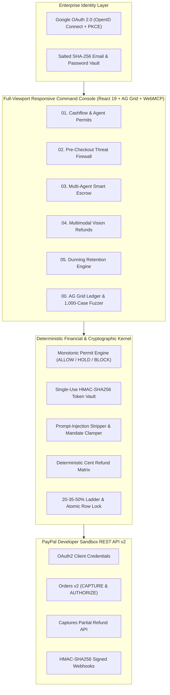

# AegisPay OS — System Architecture & Deterministic Kernel Specification

## 1. Architectural Invariant

Across autonomous AI commerce workflows, **AegisPay OS** enforces a strict separation of duties between probabilistic language models and deterministic financial execution:

> **"AI Proposes. Deterministic Code Decides. PayPal Moves the Money."**

1. **Tier 01 — Multi-Provider AI Cognitive Mesh (`server/gemini.ts`)**:
   - **Primary Engine**: Google Gemini 2.5 Flash (`gemini-2.5-flash`) for structured semantic fraud analysis, multi-agent negotiation proposals, multimodal physical defect extraction, and empathetic customer retention dialogue.
   - **Automatic Secondary Failover**: Groq Cloud LPU (`llama-3.3-70b-versatile` and `meta-llama/llama-4-scout-17b-16e-instruct`) automatically engages within milliseconds whenever the primary provider returns HTTP `429` (rate limit), `5xx`, or exceeds latency bounds.
   - **Zero Pricing Authority**: AI output schemas contain zero authoritative monetary or discount fields.
2. **Tier 02 — Deterministic Financial & Cryptographic Kernel (`shared/kernel.ts`)**:
   - **Monotonic Spending Permits (`evaluateAgentPermit`)**: Guarantees that an AI confidence score or verdict can make a spending decision *stricter* (`ALLOW -> HOLD -> BLOCK`), never *looser*.
   - **Single-Use HMAC-SHA256 Review Tokens (`ScamShieldTokenVault`)**: Cryptographically binds a pre-checkout security review to the exact PayPal Order amount, currency, payee hash, and 5-minute TTL.
   - **Mandate Boundary Clamping (`validateAndClampOfferAgainstMandate`)**: Strips prompt-injection payloads and clamps multi-agent negotiation offers to confidential buyer ceilings and seller floors.
   - **Merchant Defect Pricing Matrix (`calculateDeterministicVisionRefund`)**: Maps non-monetary vision defect telemetry (`defectCategory`, `severityTier`, `affectedSurfacePct`) to exact cent refunds while blocking duplicate image hashes.
   - **Fixed Concession Ladder & Circuit Breakers (`evaluateChurnIntervention`)**: Enforces `20% -> 35% -> 50%` retention caps, blocks accounts with `>=60%` feature utilization from discount gaming, and trips a `0%` lock + Zapier escalation on legal/dispute keywords.
3. **Tier 03 — PayPal Developer Platform Settlement (`server/paypal.ts`)**:
   - Executes live PayPal Sandbox REST API v2 calls (`/v1/oauth2/token`, `/v2/checkout/orders` with `CAPTURE` and `AUTHORIZE` intents, `/v2/payments/authorizations/{id}/capture`, `/v2/payments/captures/{id}/refund`, and `/v1/notifications/verify-webhook-signature`).

---

## 2. End-to-End Execution Topology

