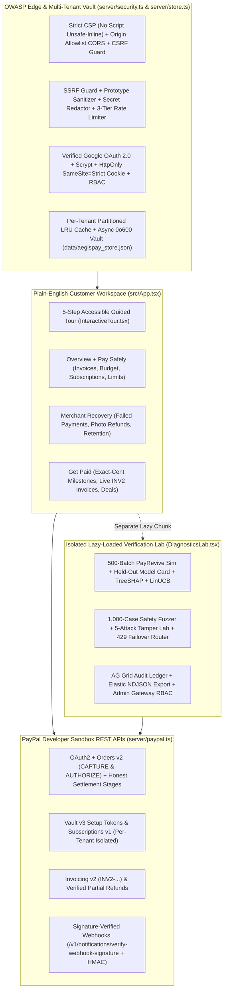

# AegisPay v3.1 - System Architecture, Security & ML Specification

## 1. Separation of Concerns: Customer Product vs. Verification Lab

**AegisPay v3.1** enforces two architectural boundaries simultaneously:
1. **Execution Separation**: *"AI Proposes. Deterministic Code Decides. PayPal Moves the Money."*
2. **Experience Separation**: Customer-facing workflows (`LandingPage`, `WorkspaceOverview`, `PaySafelyView`, `MerchantRecoveryView`, `GetPaidView`, and `InteractiveTour`) present clear, plain-English financial controls, while all internal ML telemetry, adversarial fuzzers, tamper simulations, and audit benchmarks live inside the lazy-loaded **`DiagnosticsLab`** (`React.lazy`).

---

## 2. Three-Tier Technical Architecture

1. **Tier 01 - Multi-Provider Cognitive & Trained ML Layer (`server/gemini.ts`, `shared/payrevive.ts`, `shared/payreviveModelArtifact.ts`)**:
   - **Google Gemini + Groq Cloud LPU Failover**: Structured semantic fraud review, grounded policy compilation, multi-agent negotiation, vision defect telemetry, and automatic HTTP `429` failover guarded by `meta-llama/llama-prompt-guard-2-86m`.
   - **Trained 16-Tree Second-Order Newton GBDT + Exact TreeSHAP**: Offline trainer (`scripts/train-payrevive-gbdt.ts`) fits a 16-tree Newton GBDT ensemble (`Held-Out ROC-AUC = 0.8301`, `Brier Score = 0.1403`) with exact path-dependent TreeSHAP attribution (`additivityDelta < 1e-6`).
2. **Tier 02 - Deterministic Financial, LinUCB Bandit & Compliance Kernel (`shared/kernel.ts`, `shared/payrevive.ts`)**:
   - **Disjoint LinUCB Contextual Bandit & Hard Compliance Gate**: Per-arm ridge regression with exact `O(d^2)` Sherman-Morrison inverse updates (`theta_a = A_a^-1 b_a`). Executes an arm only when `ExpectedNetGainCents > 0` AND all deterministic compliance rules pass (`0` refused actions executed across `10,000` simulated failures). Arm weights update strictly on settlement confirmation (`POST /api/payrevive/confirm-settlement`).
   - **Monotonic Permits, Single-Use HMAC Tokens, Mandate Clamping & Hamilton Splits**: Enforces `ALLOW -> HOLD -> BLOCK` monotonicity, 5-minute single-use checkout tokens, ZOPA ceiling/floor clamps, per-tenant cent refund matrices, `20-35-50%` retention ladders, and `0-cent` drift milestone splits.
3. **Tier 03 - OWASP-Hardened Multi-Tenant Vault & PayPal Sandbox Execution (`server/security.ts`, `server/store.ts`, `server/paypal.ts`)**:
   - **Zero-Trust Auth, RBAC, CSRF & SSRF Guards**: Verified Google OAuth 2.0 + OAuth CSRF `state` cookie, `crypto.scryptSync` accounts, `HttpOnly; SameSite=Strict` cookies (zero `localStorage` tokens), Origin Allowlist CORS, `X-Requested-With` CSRF validation, SSRF URL blocking (`validateSafeExternalUrl`), `PRINCIPAL_ARCHITECT` RBAC, and non-blocking `fs.promises` `0o600` vault writes.
   - **Honest PayPal Sandbox Settlement & Verified Webhooks**: Tracks explicit settlement stages (`LIVE_PAYER_APPROVAL_READY` vs `LIVE_BUYER_CAPTURED`), isolates orders/invoices/vault/subscriptions per `ownerTenantId`, and verifies webhook signatures (`POST /api/paypal/webhook`).

---

## 3. End-to-End Execution Topology

