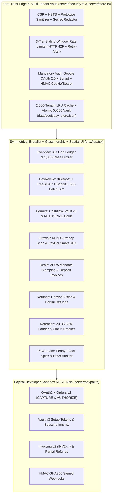

# AegisPay OS v3.0 - System Architecture, Security & PayRevive Specification

## 1. Core Separation-of-Duties Invariant

> **"AI Proposes. Deterministic Code Decides. PayPal Moves the Money."**

1. **Tier 01 - Multi-Provider Cognitive & ML Layer (`server/gemini.ts`, `shared/payrevive.ts`)**:
   - **Google Gemini + Groq Cloud LPU Failover**: Structured semantic fraud review, grounded policy compilation, multi-agent negotiation, vision defect extraction, and sub-second HTTP `429` failover (`openai/gpt-oss-120b` & `qwen/qwen3.8-27b`) guarded by `meta-llama/llama-prompt-guard-2-86m`.
   - **PayRevive XGBoost + Exact TreeSHAP**: 12-tree Gradient Boosted Decision Tree ensemble over 8 telemetry features with exact path-dependent TreeSHAP attribution (`baseLogOdds + sum(phi_i) == rawMarginLogOdds`, `delta < 1e-6`).
2. **Tier 02 - Deterministic Financial, Bandit & Compliance Kernel (`shared/kernel.ts`, `shared/payrevive.ts`)**:
   - **Cost-Aware Contextual Bandit & Hard Compliance Gate**: Executes a recovery arm only when `ExpectedNetGainCents > 0` AND all deterministic compliance rules pass (`0` prohibited actions across `10,000` simulated failures).
   - **Monotonic Permits, Single-Use HMAC Tokens, Mandate Clamping & Hamilton Splits**: Enforces `ALLOW -> HOLD -> BLOCK` monotonicity, 5-minute single-use checkout tokens, ZOPA ceiling/floor clamps, merchant cent refund matrices, `20-35-50%` retention ladders, and `0-cent` drift milestone splits.
3. **Tier 03 - Zero-Trust Multi-Tenant Vault & PayPal Sandbox Execution (`server/security.ts`, `server/store.ts`, `server/paypal.ts`)**:
   - **Mandatory Auth & Isolated Persistence**: Google OAuth 2.0 + `crypto.scryptSync` accounts, `HttpOnly; SameSite=Strict` cookies + HMAC-SHA256 bearer sessions, `2,000`-tenant LRU workspace partitioning, atomic `0o600` vault writes (`data/aegispay_store.json`), and 3-tier sliding-window rate limiting (`RateLimit-*` / `HTTP 429`).
   - **PayPal REST Execution**: OAuth2, Orders v2 (`CAPTURE` & `AUTHORIZE`), Authorizations Capture/Void, Captures Partial Refund, Invoicing v2 (`INV2-...`), Vault v3 Setup Tokens, Subscriptions v1 (`I-...`), and Signed Webhooks.

---

## 2. End-to-End Execution Topology

