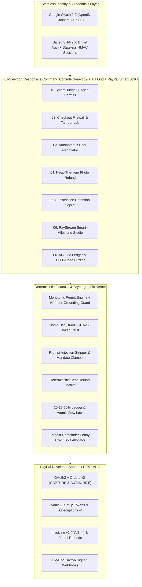

# AegisPay OS - System Architecture & Deterministic Kernel Specification

## 1. Architectural Invariant

Across autonomous AI commerce workflows, **AegisPay OS** enforces a strict separation of duties between probabilistic language models and deterministic financial execution:

> **"AI Proposes. Deterministic Code Decides. PayPal Moves the Money."**

1. **Tier 01 - Multi-Provider AI Cognitive Mesh (`server/gemini.ts`)**:
   - **Primary Engine**: Google Gemini 3.5 (`gemini-3.5-flash-lite` / `gemini-3.8-flash`) for structured semantic fraud analysis, natural-language policy compilation, multi-agent negotiation proposals, multimodal physical defect extraction, deliverable scope decomposition, and empathetic customer retention dialogue.
   - **Automatic Secondary Failover**: Groq Cloud LPU (`openai/gpt-oss-120b` for structured text and `qwen/qwen3.8-27b` for multimodal vision) engages within milliseconds whenever the primary provider returns HTTP `429` (rate limit), `5xx`, or exceeds latency bounds.
   - **Neural Prompt-Injection Defense**: Groq `meta-llama/llama-prompt-guard-2-86m` inspects untrusted invoice text, proof notes, and policy sentences alongside deterministic regex rules.
   - **Zero Pricing Authority**: AI output schemas contain zero authoritative monetary or discount fields.
2. **Tier 02 - Deterministic Financial & Cryptographic Kernel (`shared/kernel.ts`)**:
   - **Monotonic Spending Permits (`evaluateAgentPermit`)**: Guarantees that an AI confidence score or verdict can make a spending decision *stricter* (`ALLOW -> HOLD -> BLOCK`), never *looser*, while `verifyGroundedNumbers` blocks hallucinated policy numbers.
   - **Single-Use HMAC-SHA256 Review Tokens (`ScamShieldTokenVault`)**: Cryptographically binds a pre-checkout security review to the exact PayPal Order amount, currency, payee hash, and 5-minute TTL.
   - **Mandate Boundary Clamping (`validateAndClampOfferAgainstMandate`)**: Strips prompt-injection payloads and clamps multi-agent negotiation offers to confidential buyer ceilings and seller floors.
   - **Merchant Defect Pricing Matrix (`calculateDeterministicVisionRefund`)**: Maps non-monetary vision defect telemetry (`defectCategory`, `severityTier`, `affectedSurfacePct`) to exact cent refunds while blocking duplicate image hashes.
   - **Fixed Concession Ladder & Circuit Breakers (`evaluateChurnIntervention`)**: Enforces `20% -> 35% -> 50%` retention caps, blocks accounts with `>=60%` feature utilization from discount gaming, and trips a `0%` lock + Zapier escalation on legal/dispute keywords.
   - **Penny-Exact Largest-Remainder Splits (`allocatePennyExact` & `computePennyExactMilestonePlan`)**: Guarantees `sum(milestones) == totalBudgetCents` and `sum(collaboratorSplits) == milestone.amountCents` with zero cent rounding drift.
3. **Tier 03 - PayPal Developer Platform Settlement (`server/paypal.ts`)**:
   - Executes live PayPal Sandbox REST API calls: OAuth2 `/v1/oauth2/token`, Orders v2 `/v2/checkout/orders` (`CAPTURE` & `AUTHORIZE`), Vault v3 `/v3/vault/setup-tokens`, Invoicing v2 `/v2/invoicing/invoices` (`INV2-...`), Catalogs & Subscriptions v1 `/v1/billing/subscriptions` (`I-...`), Authorizations Capture/Void, Captures Partial Refund `/v2/payments/captures/{id}/refund`, and Signed Webhooks.

---

## 2. End-to-End Execution Topology

